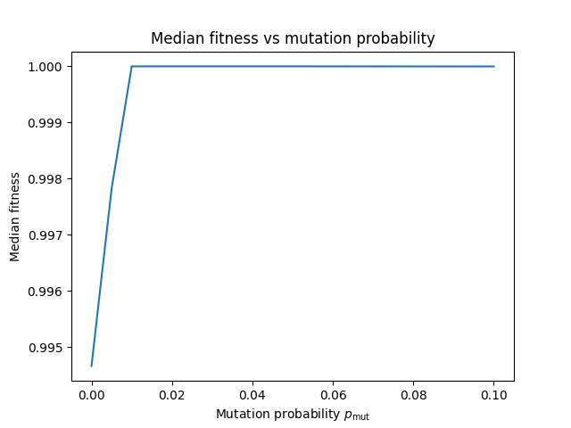

# Genetic algorithm

A binary-encoded genetic algorithm that minimises

`g(x₁, x₂) = (1.5 − x₁ + x₁x₂)² + (2.25 − x₁ + x₁x₂²)² + (2.625 − x₁ + x₁x₂³)²`

on [−5, 5]², using the fitness `1 / (g + 1)`. The global minimum is g = 0 at (3, 0.5).

- 50-bit chromosomes (25 bits per variable)
- Tournament selection, single-point crossover, bit-flip mutation
- Elitism: the best individual is copied unchanged into the next generation

| File | Purpose |
|---|---|
| `genetic_algorithm.py` | The GA itself |
| `run_single.py` | A single run with tuned parameters |
| `run_batch.py` | 100 runs for each mutation probability, plotting median fitness |



Without mutation the population converges prematurely. From p_mut ≈ 0.01 (≈ 1/number of genes) upwards, the median run finds the optimum.

```bash
python run_single.py
python run_batch.py   # slow: 6 × 100 runs × 2000 generations
```
